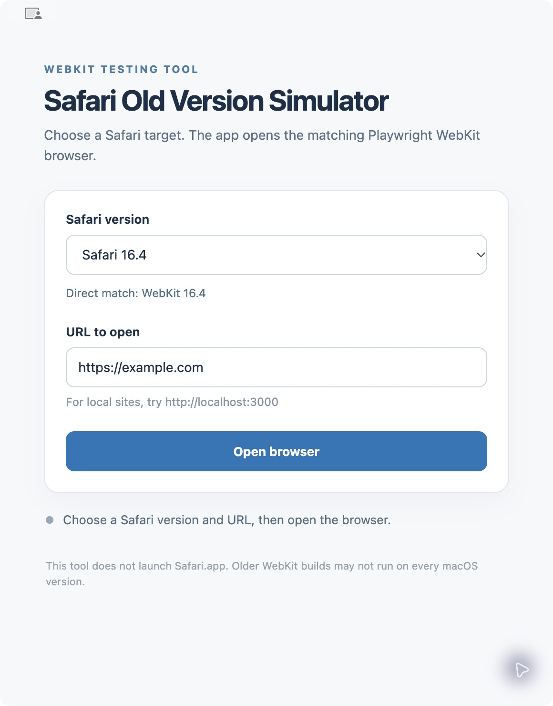
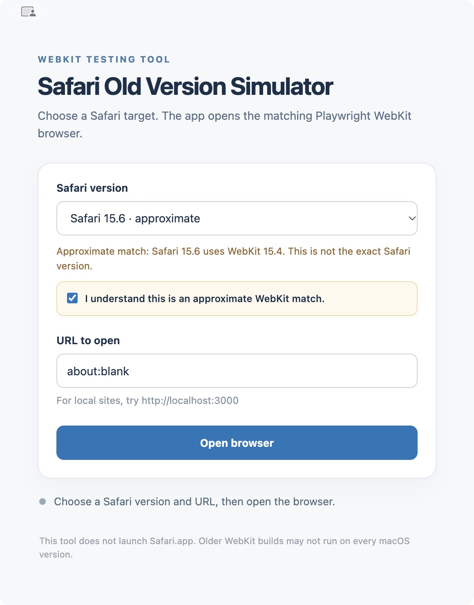
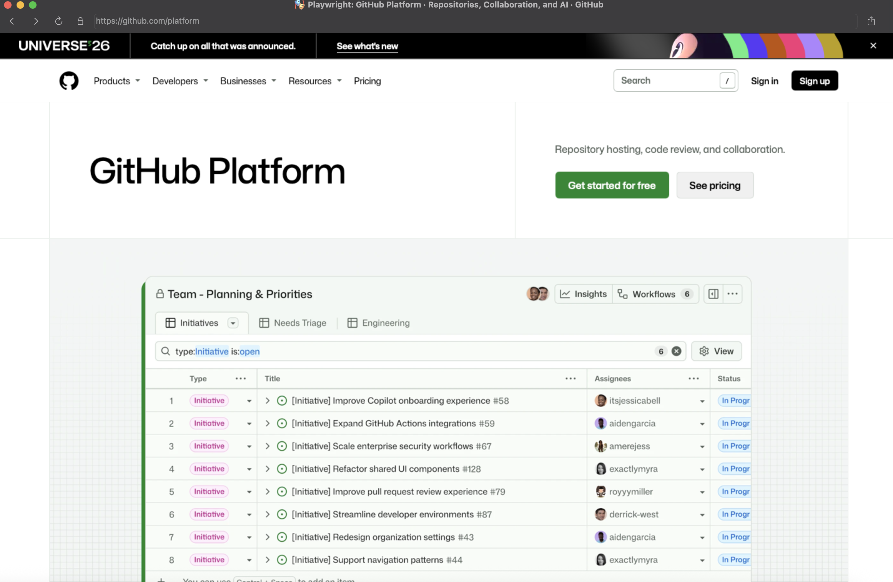

# Safari Old Version Simulator

**Test websites against historical Safari WebKit builds on your Mac.** Safari Old Version Simulator is a macOS desktop app and Node.js tool that lets you select a Safari version, then opens the corresponding pinned **Playwright WebKit** browser. It is useful for checking CSS, JavaScript, and website behavior across older WebKit versions without changing your installed Safari.

> This is a WebKit simulation, not an Apple Safari app or an iOS simulator. Some Safari selections use an approximate WebKit match. Historical browser builds may fail to launch on newer macOS versions.

## Screenshots







The selected website opens in a separate Playwright WebKit window.

## Download the macOS app

Download the [Safari Old Version Simulator v1.0.0 release](https://github.com/omerozselcuk/safari-old-version-simulator/releases/tag/v1.0.0) for **Apple Silicon (arm64)**. Unzip it and open `Safari Old Version Simulator.app`. The app includes Node.js 22 and npm, so they do not need to be installed separately for the desktop download. An internet connection is needed the first time each selected Playwright and WebKit build is downloaded; later launches reuse the downloaded runtime.

The release is ad-hoc signed and **not notarized with Apple Developer ID**. macOS Gatekeeper may warn or block it. For distribution without this warning, the app needs Developer ID signing and notarization. You can also build it locally from source.

1. Select a **Safari version**.
2. Enter a URL, such as `https://example.com` or `http://localhost:3000`.
3. If the selection is approximate, acknowledge the WebKit version shown in the app.
4. Choose **Open browser**. Close its window or choose **Close browser** when finished.

The app remembers the last selection. It opens the website in a separate Playwright WebKit window; it does not reproduce Safari's address bar or browser chrome.

## Run or build from source

Use Node.js 22 LTS and npm on macOS. From the repository root:

```bash
npm install
npm run desktop
```

To build the Apple Silicon app:

```bash
npm run desktop:build
```

The output is `dist/mac-arm64/Safari Old Version Simulator.app`. The first browser launch downloads the selected Playwright package and WebKit build. Desktop downloads are stored in the app's user data directory.

## Supported Safari targets

Each target is pinned to a Playwright package, WebKit version, and browser revision. A target ending in `.0`, such as `16.4.0`, is accepted as the same version family as `16.4`; it does **not** represent an exact Safari patch release.

| Safari selection | WebKit used | Playwright | Revision | Match |
| --- | --- | --- | --- | --- |
| 15.0 | 15.0 | 1.15.2 | 1550 | Direct |
| 15.1–15.3 | 15.0 | 1.15.2 | 1550 | Approximate |
| 15.4 | 15.4 | 1.23.4 | 1668 | Direct |
| 15.5–15.6 | 15.4 | 1.23.4 | 1668 | Approximate |
| 16.4 | 16.4 | 1.32.1 | 1811 | Direct |
| 17.0 | 17.0 | 1.37.1 | 1883 | Direct |
| 17.4 | 17.4 | 1.43.1 | 1992 | Direct |
| 18.0 | 18.0 | 1.48.2 | 2083 | Direct |
| 18.4 | 18.4 | 1.52.0 | 2158 | Direct |

Approximate selections require `allowApproximateVersion: true` in the CLI configuration, or an explicit acknowledgement in the desktop app. The actual WebKit version is displayed; the tool does not spoof the Safari User-Agent. The source links for the pinned revisions are in [`webkit-versions.json`](webkit-versions.json). Runtime installation verifies the selected package and revision.

## Command line usage

The Node.js entry point uses [`safari.config.json`](safari.config.json). For example:

```json
{
  "safariVersion": "15.6.0",
  "allowApproximateVersion": true,
  "url": "http://localhost:3000",
  "headless": false,
  "viewport": { "width": 1440, "height": 900 },
  "ignoreHTTPSErrors": false
}
```

Run these commands from the repository root:

```bash
npm start                         # Open the configured WebKit browser
npm run check                     # Check the version mapping without downloading
npm run browsers:install          # Download the configured WebKit build
npm run smoke                     # Run a headless DOM, JavaScript, and CSS check
npm test                          # Run configuration and mapping tests
npm start -- --config ./safari.config.json
```

The config is read on startup, so restart the command after editing it. The default URL is `about:blank`. CLI runtimes are cached in `.runtimes/playwright-<version>/` and `.runtimes/browsers/`. When installing older WebKit builds, the tool uses Node 20 or 22; if necessary, set `SAFARI_INSTALL_NODE` to the absolute path of a compatible Node executable.

You can also call the launcher from a Playwright script:

```js
import { openSafari } from './scripts/safari.mjs';

const { browser, page } = await openSafari();
try {
  await page.goto('http://localhost:3000');
  console.log(await page.title());
} finally {
  await browser.close();
}
```

`openSafari('./my-config.json', { headless: true })` is supported. Use a new Node process when switching WebKit versions.

## Compatibility and limitations

Playwright launches its own patched WebKit build, not a historical Safari.app or macOS/iOS installation. Safari UI, Apple DRM/FairPlay, system codecs, HLS integration, and iOS behavior may differ from a real device. For an exact Safari release, test on the corresponding macOS or iOS device, a suitable virtual machine, or a service with real Safari browsers.

Older WebKit binaries depend on the host macOS version and CPU architecture. In particular, Safari 15 WebKit builds can exit with `Target closed` on recent macOS systems, including macOS 15.7.9. The tool does not silently replace a failed historical build with the latest WebKit. It also checks the launched engine version so an operating system specific revision cannot be mistaken for the selected target.

For macOS 26, the launcher adds the missing `SYS_ulock_wait2` permission to WebKit 15 process sandbox profiles when applicable and backs up the original profiles. This compatibility adjustment does not guarantee that those historical builds will run.
